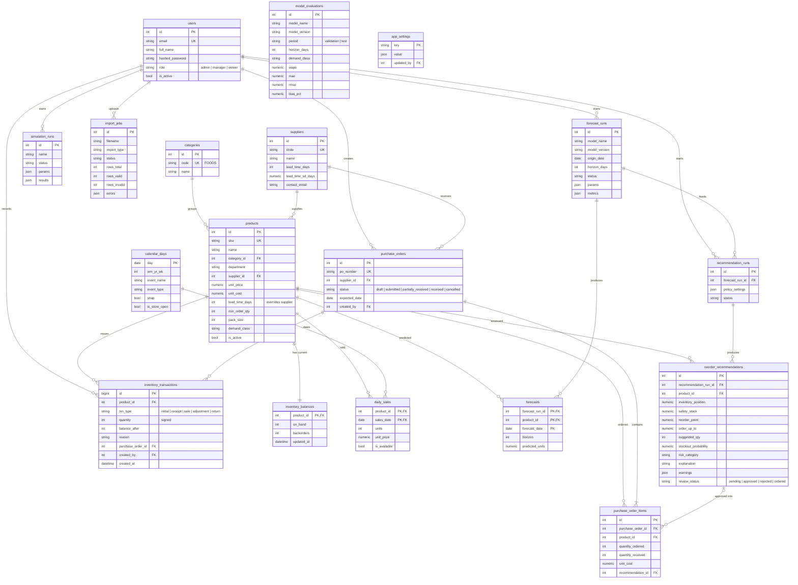

# Phase 5, Step 1: Database Design

Code: [backend/app/models/](../backend/app/models/). Migration: [backend/alembic/versions/](../backend/alembic/versions/).

## 1. Design principles

| Principle | How it is applied |
|---|---|
| **Normalised** | Suppliers, categories and products are separate tables linked by foreign keys, so a supplier's lead time is stored once |
| **History ≠ current state** | `inventory_transactions` is an append-only log of every stock movement; `inventory_balances` holds only the current numbers. Each change to the balance writes a transaction in the **same database transaction** |
| **On-order is derived** | Stock on order = Σ(ordered − received) over open purchase-order lines. It is not stored twice, so it cannot drift out of sync |
| **Runs are recorded** | Every forecast, recommendation set, simulation and CSV import is a "run" row with its settings, status, creator and timestamps, so results are traceable |
| **Constraints in the database** | Unique SKUs and PO numbers; CHECK constraints for non-negative stock, positive pack sizes, valid statuses and probabilities between 0 and 1. Invalid data is rejected even if the API has a bug |
| **Money as NUMERIC** | Prices and costs use `NUMERIC(12,2)`, never floating point, so cents never drift |
| **Portable status fields** | Statuses are `VARCHAR` + `CHECK` (SQLAlchemy `Enum(native_enum=False)`), easier to migrate than PostgreSQL enum types |
| **Timestamps** | `created_at` / `updated_at` with time zone, set by the database |

## 1a. Shops (multi-tenancy)

Each business using the app is a **shop**. Its products, stock, sales, orders, forecasts, recommendations, settings and users are private to it.

| Rule | How |
|---|---|
| Every shop-owned table has `shop_id` (FK to `shops`, indexed) | All tables except `shops` and `calendar_days` (dates and festivals are shared facts) |
| Queries see only the current shop | One SQLAlchemy session filter ([backend/app/db/tenancy.py](../backend/app/db/tenancy.py)) adds `shop_id = <the user's shop>` to every select, update, delete and `Session.get`, including joins. Another shop's ids are "not found" |
| Fail closed | A query on shop data with no shop chosen is refused, never answered with every shop's rows |
| New rows | Get the current shop's id automatically; a row for another shop is refused |
| Uniqueness per shop | `(shop_id, sku)`, `(shop_id, code)` for categories and suppliers, `(shop_id, po_number)`; PO numbers count per shop. Emails stay unique everywhere, because the email decides the shop at login |
| Forecast models | One file per shop, `models/shop_<id>_random_forest.joblib`, trained on that shop's sales |

Migration `7d2e4b9a1c30_shops` adds this to an existing database and puts any existing rows into one shop called "My shop". Tests: [backend/tests/test_shop_isolation.py](../backend/tests/test_shop_isolation.py).

## 2. ER diagram



## 3. Table notes

| Table | Purpose | Key rules |
|---|---|---|
| `users` | Login and role-based access | Unique email; role ∈ admin / manager / viewer; passwords stored only as hashes |
| `categories` | FOODS, HOBBIES, HOUSEHOLD | Unique code |
| `suppliers` | Lead time and its variability | lead_time_days ≥ 1; SD ≥ 0 |
| `products` | Master data | Unique SKU; price/cost ≥ 0; MOQ and pack ≥ 1; optional lead-time override |
| `inventory_balances` | Current stock only | One row per product; on_hand ≥ 0 and backorders ≥ 0 |
| `inventory_transactions` | Audit log of every movement | Quantity ≠ 0; balance_after ≥ 0; never updated or deleted by the app |
| `calendar_days` | Weekday, events, SNAP, closures | Used for forecast features; Christmas = closed |
| `daily_sales` | Demand history per product and day | Composite key (product, date); units ≥ 0 |
| `purchase_orders` / `_items` | Draft and real orders | Received ≤ ordered; one line per product per PO. Orders are never sent to suppliers automatically |
| `forecast_runs` / `forecasts` | Each forecast batch and its predictions | Run records the model version, origin, horizon and metrics; predictions ≥ 0 |
| `model_evaluations` | Backtest scores (Phase 3) for the Forecasting page | One row per model, period, horizon and demand class |
| `recommendation_runs` / `reorder_recommendations` | Engine output with explanation | One recommendation per product per run; probability in [0, 1]; review status tracks approval |
| `simulation_runs` | Phase 4 experiments started from the app | Params and summary results stored as JSON |
| `import_jobs` | CSV uploads | Counts of valid and invalid rows, plus row-level errors |
| `app_settings` | Policy and forecasting settings | Key-value with JSON values |

## 4. Setting up the database (Windows 11)

Either database works; the app only reads `DATABASE_URL` from `.env`.

**Option A: PostgreSQL installed on Windows** (used during development)

1. Copy `.env.example` to `.env` and choose your own password in **both** `POSTGRES_PASSWORD` and `DATABASE_URL`; set the port in `DATABASE_URL` to `5432`.
2. In pgAdmin, logged in as `postgres`, run each line separately:
   ```sql
   CREATE ROLE inventory LOGIN PASSWORD 'the-password-from-.env';
   CREATE DATABASE inventory OWNER inventory;
   ```

**Option B: Docker** (`docker compose up -d db`, port 5433). See Phase 8.

**Then, from the `backend` folder:**

```bash
..\.venv\Scripts\python.exe scripts\check_db.py      # connection check (never prints the password)
..\.venv\Scripts\alembic.exe upgrade head            # create / update all tables
..\.venv\Scripts\alembic.exe check                   # models and database match?
```

**Verified on PostgreSQL 18.4:** the migration `5c7941a3cf1d_initial_schema` creates 18 tables (+ `alembic_version`). `alembic check` reports no drift. Downgrade to empty and upgrade again both succeed. The 6 integration tests in `backend/tests/test_postgres_schema.py` (`pytest -m postgres`) confirm that PostgreSQL itself rejects duplicate SKUs, negative stock, unknown statuses and over-receiving, stores money exactly, and uses JSONB. These tests roll back, leaving the database unchanged, and are skipped when no database is reachable.

**Windows note:** `alembic.ini` sets `path_separator = os`. Without it, Alembic splits paths on spaces and fails in folders whose names contain spaces (like this project's).

## 5. Indexes beyond primary and unique keys

- `daily_sales(sales_date)`: dashboard trends by date.
- `inventory_transactions(product_id, created_at)`: movement history per product.
- `forecasts(product_id, forecast_date)`: latest forecast for a product.
- `reorder_recommendations(risk_category)`: filtering the recommendations page.
- `purchase_orders(status)`, `products(category_id)`, `products(supplier_id)`.
