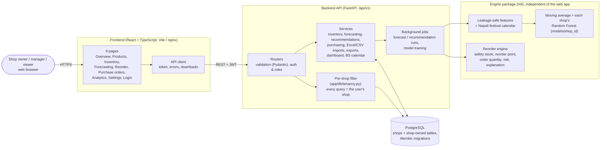
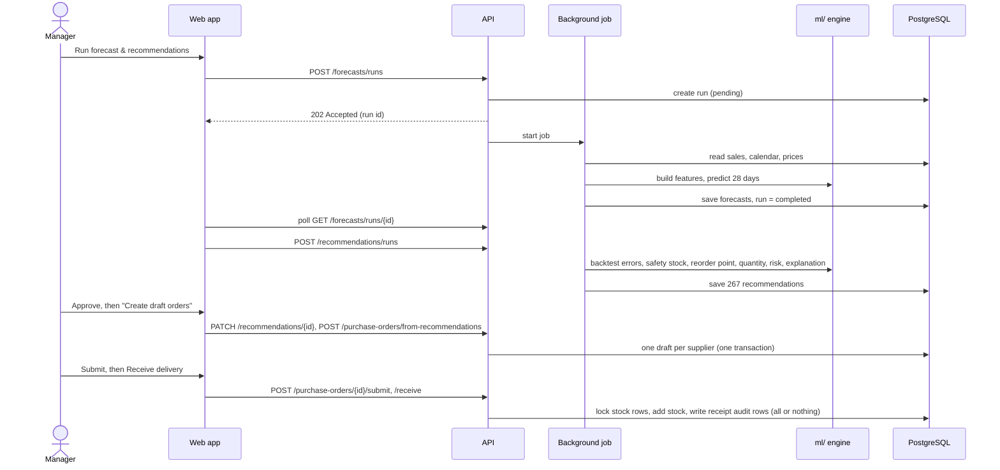
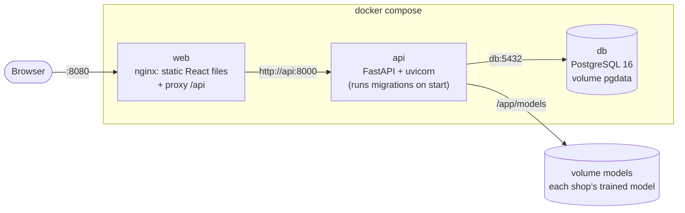

# System Architecture

## 1. Overview

**The key design decisions:**

- **The API does not re-implement any formula.** Forecasting, safety stock, reorder points and risk rules live in one tested Python package (`ml/`), first validated in the capstone research and now used directly on each shop's own data.
- **Shops are kept apart in one place.** A session filter adds "this shop only" to every query, and refuses a query with no shop chosen, so no page or service can forget it ([10_database_design.md](10_database_design.md), section 1a).
- **Dates are stored in AD and shown in Bikram Sambat.** Conversion uses one table on both sides (backend and browser), so they never disagree.

## 2. Layers and responsibilities

| Layer | Folder | Responsibility | Must not |
|---|---|---|---|
| Presentation | `frontend/src/pages`, `components` | Show data, collect input, check forms, show roles' options | Calculate business results |
| API client | `frontend/src/api` | One place for HTTP: token, errors, 401 logout, downloads | — |
| Routers | `backend/app/api/v1` | HTTP: parameters, status codes, which role may call | Contain business logic |
| Schemas | `backend/app/schemas` | Validate input and shape output (Pydantic) | Touch the database |
| Services | `backend/app/services` | Business rules and transactions (e.g. stock only changes through `apply_movement`) | Know about HTTP |
| Models | `backend/app/models` | Tables, keys, constraints (SQLAlchemy) | — |
| Engine | `ml/` | Features, festival calendar, models, metrics, reorder formulas | Depend on the web app |

## 3. Main flow: from sales to a received order

## 4. Deployment (Docker Compose)

- **One public port** (8080). The browser talks only to nginx, which serves the React files and forwards `/api` to the API, so there is no cross-origin set-up.
- The API container runs `alembic upgrade head` before starting, and runs as a non-root user.
- **Secrets** come from `.env` (never committed). `JWT_SECRET_KEY` is required; Compose refuses to start without it.
- **Trained models** are kept in the `models` volume, so retraining is not lost when the image is rebuilt.

## 5. Security summary

| Concern | Measure |
|---|---|
| Passwords | PBKDF2-SHA256, 600,000 iterations, random salt; never returned by the API |
| Login | JWT (HS256, 60 min). The user is reloaded on every request, so deactivation takes effect at once. Login errors look the same for unknown email, wrong password and inactive account |
| Access | Viewer / manager / admin roles checked by the API on every change (the UI hides controls too, but the API is the authority) |
| Input | Pydantic validation; database CHECK, UNIQUE and FK constraints; parameterised queries via the ORM |
| Data integrity | Stock changes only through one audited function, with row locks; all-or-nothing transactions for receipts, imports and orders |
| Files | Excel/CSV import: ≤ 5 MB, every row validated, all-or-nothing. CSV export: formula injection blocked |
| Shops | Every shop-owned row carries `shop_id`; one session filter limits all queries to the user's shop and fails closed; isolation is tested per endpoint and in the browser |
| Secrets | `.env` git-ignored; random dev passwords; e2e accounts get new random passwords each run |
| Known limits | Token in `sessionStorage` (HttpOnly cookie in production); no login rate limiting; HTTPS needed for any real deployment |

## 6. Database

See the ER diagram in [10_database_design.md](10_database_design.md): 18 tables, including `shops`, `inventory_balances` (current stock) kept separate from `inventory_transactions` (append-only audit log), forecast/recommendation **runs** with their settings, and purchase orders with lines.
