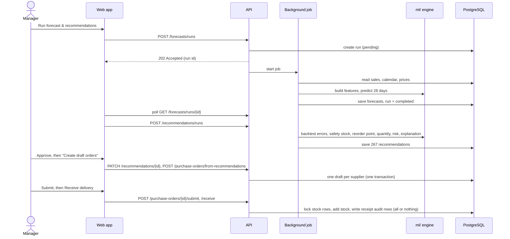
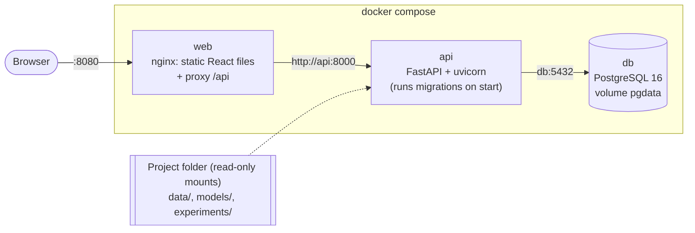

# System Architecture

## 1. Overview

```mermaid
flowchart LR
    user([Store manager / viewer<br/>web browser])

    subgraph web["Frontend (React + TypeScript, Vite / nginx)"]
        pages["9 pages<br/>Overview, Products, Inventory,<br/>Forecasting, Reorder, Purchase orders,<br/>Analytics, Settings, Login"]
        client["API client<br/>token, errors, downloads"]
    end

    subgraph api["Backend API (FastAPI, /api/v1)"]
        routers["Routers<br/>validation (Pydantic), auth & roles"]
        services["Services<br/>inventory, forecasting, recommendations,<br/>purchasing, imports, exports, dashboard"]
        jobs["Background jobs<br/>forecast / recommendation /<br/>simulation runs"]
    end

    subgraph ml["Research package (ml/), shared with experiments"]
        features["Leakage-safe features"]
        models["Baselines + Random Forest<br/>(models/*.joblib)"]
        engine["Reorder engine<br/>safety stock, reorder point,<br/>order quantity, risk, explanation"]
        sim["Inventory simulator"]
    end

    db[("PostgreSQL<br/>18 tables, Alembic migrations")]
    files[["Research files<br/>M5 data, synthetic settings,<br/>experiment results"]]

    user -- HTTPS --> pages --> client -- "REST + JWT" --> routers --> services
    services --> jobs
    services <--> db
    jobs --> features --> models
    jobs --> engine
    jobs --> sim
    sim --> files
    services -. seed.py .-> files
```

**The key design decision:** the API does **not** re-implement any formula. Forecasting, safety stock, reorder points, risk rules and the simulation live in one tested Python package (`ml/`). The research experiments and the web app both call this package, so the numbers in the report and in the app come from the same code.

## 2. Layers and responsibilities

| Layer | Folder | Responsibility | Must not |
|---|---|---|---|
| Presentation | `frontend/src/pages`, `components` | Show data, collect input, check forms, show roles' options | Calculate business results |
| API client | `frontend/src/api` | One place for HTTP: token, errors, 401 logout, downloads | — |
| Routers | `backend/app/api/v1` | HTTP: parameters, status codes, which role may call | Contain business logic |
| Schemas | `backend/app/schemas` | Validate input and shape output (Pydantic) | Touch the database |
| Services | `backend/app/services` | Business rules and transactions (e.g. stock only changes through `apply_movement`) | Know about HTTP |
| Models | `backend/app/models` | Tables, keys, constraints (SQLAlchemy) | — |
| Research / engine | `ml/` | Features, models, metrics, reorder formulas, simulation | Depend on the web app |

## 3. Main flow: from sales to a received order



## 4. Deployment (Docker Compose)



- **One public port** (8080). The browser talks only to nginx, which serves the React files and forwards `/api` to the API, so there is no cross-origin set-up.
- The API container runs `alembic upgrade head` before starting, and runs as a non-root user.
- **Secrets** come from `.env` (never committed). `JWT_SECRET_KEY` is required; Compose refuses to start without it.
- **M5 data is mounted, never copied into an image**, because the competition rules do not allow redistribution.

## 5. Security summary

| Concern | Measure |
|---|---|
| Passwords | PBKDF2-SHA256, 600,000 iterations, random salt; never returned by the API |
| Login | JWT (HS256, 60 min). The user is reloaded on every request, so deactivation takes effect at once. Login errors look the same for unknown email, wrong password and inactive account |
| Access | Viewer / manager / admin roles checked by the API on every change (the UI hides controls too, but the API is the authority) |
| Input | Pydantic validation; database CHECK, UNIQUE and FK constraints; parameterised queries via the ORM |
| Data integrity | Stock changes only through one audited function, with row locks; all-or-nothing transactions for receipts, imports and orders |
| Files | CSV import: UTF-8, ≤ 5 MB, every row validated, all-or-nothing. CSV export: formula injection blocked |
| Secrets | `.env` git-ignored; random dev passwords; e2e accounts get new random passwords each run |
| Known limits | Token in `sessionStorage` (HttpOnly cookie in production); no login rate limiting; HTTPS needed for any real deployment |

## 6. Database

See the ER diagram in [10_database_design.md](10_database_design.md): 18 tables, including `inventory_balances` (current stock) kept separate from `inventory_transactions` (append-only audit log), forecast/recommendation/simulation **runs** with their settings, and purchase orders with lines.
